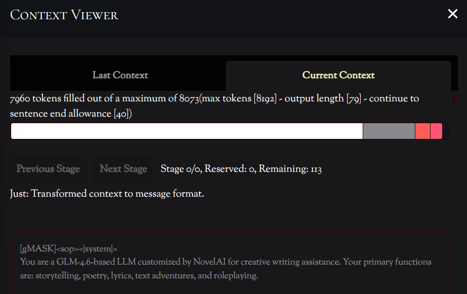

# LLM Chapter

Suggestions keyed to line numbers in `Transformers.tex` (chapter: Transformer Architectures and LLMs).

## Line-by-line suggestions

### 1.1 In-Context Processing

**<!--ref:r001-->[Line 183](https://github.com/simbrain/NeuralNetworksCogSciBook/blob/1371c5da040ff388fde37e438f47b625a71e13f8/Transformers.tex#L183)<!--/ref--> (lorebooks/anterograde amnesia)** <!--ref:r002-->[§1.1 In-Context Processing](https://github.com/simbrain/NeuralNetworksCogSciBook/blob/1371c5da040ff388fde37e438f47b625a71e13f8/Transformers.tex#L154)<!--/ref-->: I deal with this daily using NovelAI as my personal creative-writing helper, and I can actually check how much of the old history is being cut off in its Context Viewer. Besides paying for a more expensive subscription with a bigger context window, my primary solution is lorebooks (which SillyTavern also uses). Lorebooks are dynamic memory systems that store background information, such as character details, world rules, and location names, and inject it into the story context when specific trigger words appear (NovelAI supports always-active entries too). This works a lot like the external memory aids people with anterograde amnesia rely on, similar to the notes in *Memento*. It also connects to cue-dependent retrieval in cognitive science: a trigger word acts as a cue that pulls the relevant memory into working memory only when it is needed. Since lore entries can be keyword-triggered retrieval, it is also a simple version of RAG (see the [Future Chapter notes](03-future-chapter.md) for the RAG connection).

*NovelAI's Context Viewer: 7,960 of 8,073 available tokens are filled, so older story text is about to be cut off.*

**<!--ref:r003-->[Line 190](https://github.com/simbrain/NeuralNetworksCogSciBook/blob/1371c5da040ff388fde37e438f47b625a71e13f8/Transformers.tex#L190)<!--/ref--> (footnote on single-trial learning)** <!--ref:r004-->[§1.1 In-Context Processing](https://github.com/simbrain/NeuralNetworksCogSciBook/blob/1371c5da040ff388fde37e438f47b625a71e13f8/Transformers.tex#L154)<!--/ref-->: The classic connectionist answer to this critique is complementary learning systems theory (McClelland, McNaughton and O'Reilly, 1995): fast single-trial learning is handled by a hippocampus-like system, and slow learning by the neocortex. The footnote's open question ("how psychologically or neurally realistic") also now has a direct study: Russin, Pavlick and Frank (PNAS) show that the trade-offs between in-context and in-weight learning in neural networks parallel trade-offs seen in human learning.

### 1.3-1.4 Next-Word Prediction and Generating Conversations

**<!--ref:r005-->[Line 248](https://github.com/simbrain/NeuralNetworksCogSciBook/blob/1371c5da040ff388fde37e438f47b625a71e13f8/Transformers.tex#L248)<!--/ref--> (footnote on next-word prediction)** <!--ref:r006-->[§1.3 Training Using Next-Word Prediction](https://github.com/simbrain/NeuralNetworksCogSciBook/blob/1371c5da040ff388fde37e438f47b625a71e13f8/Transformers.tex#L239)<!--/ref-->: Beyond Elman, there is now neuroscience evidence that the brain itself predicts upcoming words. Goldstein et al. (*Nature Neuroscience*, 2022) found brain signals of next-word prediction before a word is heard, and argued that humans and autoregressive language models share computational principles. This would give the self-supervised training objective a cognitive science motivation, not only an engineering one, and it ties into predictive processing theories of the brain.

### 1.6 LLMs and the Cognitive Sciences

**<!--ref:r007-->[Line 718](https://github.com/simbrain/NeuralNetworksCogSciBook/blob/1371c5da040ff388fde37e438f47b625a71e13f8/Transformers.tex#L718)<!--/ref--> (comment: word norms not the most gripping example)** <!--ref:r008-->[§1.6 LLMs and the Cognitive Sciences](https://github.com/simbrain/NeuralNetworksCogSciBook/blob/1371c5da040ff388fde37e438f47b625a71e13f8/Transformers.tex#L713)<!--/ref-->: Two recent studies could serve as more gripping openers, with the word-norm results kept as supporting detail:

- **Centaur** (Binz, ..., Schulz; *Nature*, 2025): a language model fine-tuned on Psych-101, a dataset of more than 10 million choices from over 60,000 participants across 160 psychology experiments. It predicted held-out participants better than existing cognitive models, generalized to new cover stories and domains, and its internal representations became more aligned with human neural activity after fine-tuning. This also links to the fine-tuning discussion in the [Future Chapter notes](03-future-chapter.md).
- **Theory of mind** (Strachan et al., *Nature Human Behaviour*, 2024): GPT-4, GPT-3.5 and LLaMA2-70B were compared with 1,907 human participants on false belief, irony, hinting, strange stories and faux pas tests. GPT-4 matched or beat humans on most tests but failed faux pas. Follow-ups suggested this was excessive caution ("hyperconservatism") rather than an inability to infer, because GPT-4 answered correctly when asked which interpretation was more likely. That is a nice example of how fine-tuned caution can look like a cognitive deficit.

**<!--ref:r009-->[Lines 995-1002](https://github.com/simbrain/NeuralNetworksCogSciBook/blob/1371c5da040ff388fde37e438f47b625a71e13f8/Transformers.tex#L995-L1002)<!--/ref--> ("The Illusion of the Illusion of Thinking")** <!--ref:r010-->[§1.6.2 LLMs and Behavioral Sciences](https://github.com/simbrain/NeuralNetworksCogSciBook/blob/1371c5da040ff388fde37e438f47b625a71e13f8/Transformers.tex#L819)<!--/ref-->: After the rebuttal went viral, Lawsen described it as a joke that contained errors. The chapter should mention this, or pair the rebuttal with more careful critiques of the Apple paper, so that readers don't take it as a serious refutation. Critics like Lawrence Chan of METR raised substantive points, for example that a model with a code interpreter can solve Tower of Hanoi by writing a script.

**<!--ref:r011-->[Lines 1042-1072](https://github.com/simbrain/NeuralNetworksCogSciBook/blob/1371c5da040ff388fde37e438f47b625a71e13f8/Transformers.tex#L1042-L1072)<!--/ref--> (LLMs and Neuroscience)** <!--ref:r012-->[§1.6.3 LLMs and Neuroscience](https://github.com/simbrain/NeuralNetworksCogSciBook/blob/1371c5da040ff388fde37e438f47b625a71e13f8/Transformers.tex#L1042)<!--/ref-->: A strong recent example to add is Tuckute et al. (*Nature Human Behaviour*, 2024). They used a GPT-based encoding model to choose new sentences predicted to drive or suppress activity in the human language network, and the predictions held in new participants. This goes beyond predicting brain activity to using an LLM to control it noninvasively. This subsection could also mention Mahowald et al. (2024) on LLMs as models of the language network, and Han et al. (2026) on brain-like modules emerging inside LLMs (both in the [Future Chapter notes](03-future-chapter.md)).

**<!--ref:r013-->[Lines 1214-1221](https://github.com/simbrain/NeuralNetworksCogSciBook/blob/1371c5da040ff388fde37e438f47b625a71e13f8/Transformers.tex#L1214-L1221)<!--/ref--> (poverty of the stimulus)** <!--ref:r014-->[§1.6.4 LLMs and Philosophy](https://github.com/simbrain/NeuralNetworksCogSciBook/blob/1371c5da040ff388fde37e438f47b625a71e13f8/Transformers.tex#L1100)<!--/ref-->: The BabyLM Challenge, a shared task in which language models are trained on roughly the amount of language a child hears, is a natural companion to the Lan et al. citation. It is a community-wide test of how far models get on human-scale data.

**<!--ref:r015-->[Lines 1223-1228](https://github.com/simbrain/NeuralNetworksCogSciBook/blob/1371c5da040ff388fde37e438f47b625a71e13f8/Transformers.tex#L1223-L1228)<!--/ref--> ("We are not yet aware of someone making this argument in print")** <!--ref:r016-->[§1.6.4 LLMs and Philosophy](https://github.com/simbrain/NeuralNetworksCogSciBook/blob/1371c5da040ff388fde37e438f47b625a71e13f8/Transformers.tex#L1100)<!--/ref-->: This sentence may now be out of date. Yang, Campbell, Huang, Wang, Cohen and Webb, "Emergent Symbolic Mechanisms Support Abstract Reasoning in Large Language Models" (ICML 2025), report a three-stage mechanism inside LLMs: symbol abstraction heads, symbolic induction heads, and retrieval heads. They argue that this helps resolve the symbolic-versus-neural debate, because reasoning in the network relies on emergent symbolic mechanisms. That is close to the argument the chapter predicts, so the sentence could cite it instead.

### 1.7 LLMs in Practice

Most notes for this section are in the [Future Chapter notes](03-future-chapter.md), since the plan is to move it into its own chapter.

**<!--ref:r017-->[Lines 1330-1334](https://github.com/simbrain/NeuralNetworksCogSciBook/blob/1371c5da040ff388fde37e438f47b625a71e13f8/Transformers.tex#L1330-L1334)<!--/ref--> (comment on Cowan and activated long-term memory)** <!--ref:r018-->[§1.7.1 Pretraining, Post-Training, and Fine-Tuning](https://github.com/simbrain/NeuralNetworksCogSciBook/blob/1371c5da040ff388fde37e438f47b625a71e13f8/Transformers.tex#L1293)<!--/ref-->: This idea is developed in the [Future Chapter notes](03-future-chapter.md), section 2 (prompts as situational framing). If this subsection stays here for now, a sentence pointing ahead to that discussion would be enough.

**<!--ref:r019-->[Lines 1398-1406](https://github.com/simbrain/NeuralNetworksCogSciBook/blob/1371c5da040ff388fde37e438f47b625a71e13f8/Transformers.tex#L1398-L1406)<!--/ref--> (long division and environmental artifacts)** <!--ref:r020-->[§1.7.2 Prompt Engineering](https://github.com/simbrain/NeuralNetworksCogSciBook/blob/1371c5da040ff388fde37e438f47b625a71e13f8/Transformers.tex#L1336)<!--/ref-->: The PDP example could be paired with Clark and Chalmers' "The Extended Mind" (1998), the standard philosophical source for the idea that notebooks and other external artifacts can be part of a cognitive process. Chain of thought then works like a notebook the model writes for itself.

## General suggestions

**Make working memory one running thread.** The chapter compares the context window to working memory in 1.1, returns to it with chain of thought in 1.7, and mentions Cowan in a comment. A consistent thread could run through the chapter: the capacity comparison (Cowan's four chunks), the serial-position effect in long contexts (*Lost in the Middle*), and the counterargument that models lack true internal working memory (Huang et al., 2025).

**Use prediction as a bridge between training and neuroscience.** Next-token prediction (1.3) and LLM-to-brain prediction (1.6.3) are currently far apart. Goldstein et al. (2022) and predictive processing theories could link them: the training objective resembles something the brain itself appears to do.

**Refresh the opening of 1.6 with more vivid findings.** Centaur and the theory-of-mind results are recent, widely discussed, and easy to explain, which suits the comment at <!--ref:r021-->[line 718](https://github.com/simbrain/NeuralNetworksCogSciBook/blob/1371c5da040ff388fde37e438f47b625a71e13f8/Transformers.tex#L718)<!--/ref-->.

**Update claims that time has overtaken.** Three spots stood out: the GPT-4 parameter count (unconfirmed), the "Illusion of the Illusion" rebuttal (self-described as a joke), and the "not yet in print" sentence (Yang et al., 2025).

**Cross-reference the new chapter.** Once 1.7 moves, short pointers from 1.1 (memory), 1.6.3 (language network) and 1.6.4 (symbolic mechanisms) to the new chapter would keep the two chapters connected.

Possible case-study boxes for this chapter:

| Case study | Section | Cognitive-science link |
|---|---|---|
| Lorebooks in NovelAI and SillyTavern | 1.1 | Cue-dependent retrieval; memory aids in anterograde amnesia |
| Lost in the Middle | 1.1 | Primacy and recency effects |
| GPT-4 and the faux pas test | 1.6.2 | Theory of mind; caution versus inability |
| Sentences that drive or suppress the language network | 1.6.3 | Language network; encoding models |
| Emergent symbol abstraction heads | 1.6.4 | Symbolic versus connectionist debate |

## Sources

- Cowan (2001). The magical number 4 in short-term memory. *Behavioral and Brain Sciences* 24.
- Liu et al. (2024). Lost in the Middle: How Language Models Use Long Contexts. *Transactions of the ACL*.
- Huang, Sun, Wang and Dredze (2025). [Language Models Do Not Have Human-Like Working Memory](https://arxiv.org/abs/2505.10571v3).
- McClelland, McNaughton and O'Reilly (1995). Why there are complementary learning systems in the hippocampus and neocortex. *Psychological Review* 102(3).
- Russin, Pavlick and Frank. [Parallel trade-offs in human cognition and neural networks](https://ski.clps.brown.edu/papers/Russin_ICL.pdf). PNAS.
- Goldstein et al. (2022). Shared computational principles for language processing in humans and deep language models. *Nature Neuroscience*.
- Binz, ..., Schulz (2025). [A foundation model to predict and capture human cognition](https://collaborate.princeton.edu/en/publications/a-foundation-model-to-predict-and-capture-human-cognition/). *Nature* 644.
- Strachan et al. (2024). [Testing theory of mind in large language models and humans](https://www.nature.com/articles/s41562-024-01882-z.pdf). *Nature Human Behaviour*.
- Tuckute et al. (2024). [Driving and suppressing the human language network using large language models](https://dspace.mit.edu/handle/1721.1/153265). *Nature Human Behaviour*.
- Yang, Campbell, Huang, Wang, Cohen and Webb (2025). [Emergent Symbolic Mechanisms Support Abstract Reasoning in Large Language Models](https://proceedings.mlr.press/v267/yang25c.html). ICML.
- [The Decoder on the Apple reasoning paper and the "Illusion of the Illusion" rebuttal](https://the-decoder.com/apples-illusion-of-thinking-paper-shows-experts-deeply-divided-on-ai-reasoning/).
- Clark and Chalmers (1998). The Extended Mind. *Analysis* 58(1).
- BabyLM Challenge (shared task on child-scale language model training).
