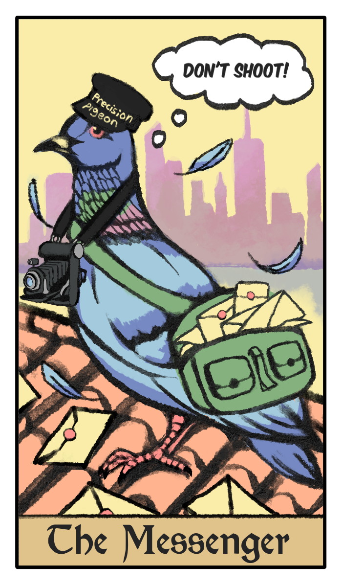
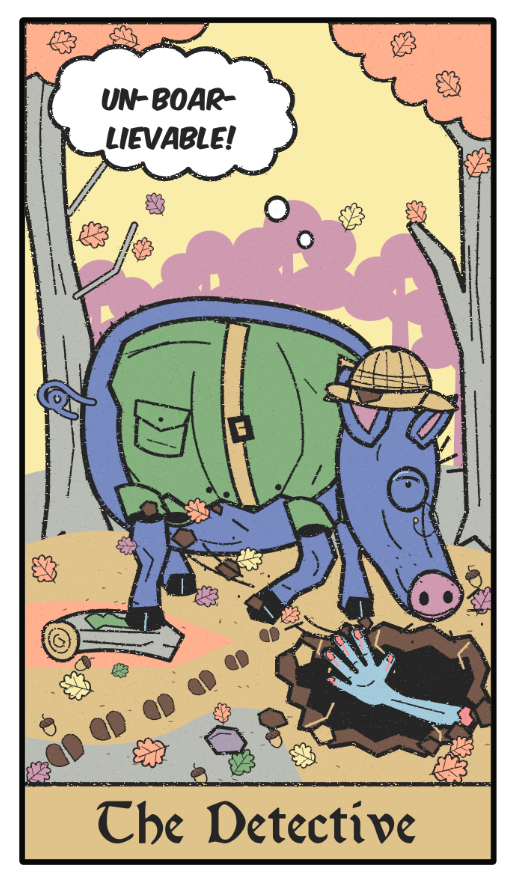

# AI Alignment Chapter

Suggestions keyed to line numbers in `AI_Alignment.tex` (chapter: AI Alignment and Post-Training).

## Line-by-line suggestions

**<!--ref:r022-->[Line 9](https://github.com/simbrain/NeuralNetworksCogSciBook/blob/1371c5da040ff388fde37e438f47b625a71e13f8/AI_Alignment.tex#L9)<!--/ref--> ("Make sure post-training is defined in transformer chapter too")** <!--ref:r023-->[§ chapter introduction](https://github.com/simbrain/NeuralNetworksCogSciBook/blob/1371c5da040ff388fde37e438f47b625a71e13f8/AI_Alignment.tex#L1)<!--/ref-->: In the transformer chapter, "post-training" currently appears only in the heading of 1.7.1 ("Pretraining, Post-Training, and Fine-Tuning"); the term is never defined in the text. A one-sentence glossary definition there, matching the one at <!--ref:r024-->[line 22](https://github.com/simbrain/NeuralNetworksCogSciBook/blob/1371c5da040ff388fde37e438f47b625a71e13f8/AI_Alignment.tex#L22)<!--/ref--> here, would fix this. If 1.7 moves to the new chapter (see the [Future Chapter notes](03-future-chapter.md)), the definition could move with it.

**<!--ref:r025-->[Line 11](https://github.com/simbrain/NeuralNetworksCogSciBook/blob/1371c5da040ff388fde37e438f47b625a71e13f8/AI_Alignment.tex#L11)<!--/ref--> ("Discuss prompt alignment?")** <!--ref:r026-->[§ chapter introduction](https://github.com/simbrain/NeuralNetworksCogSciBook/blob/1371c5da040ff388fde37e438f47b625a71e13f8/AI_Alignment.tex#L1)<!--/ref-->: The chapter already contains the best example of prompt alignment: the HHH prompt in Askell et al. (2021) at <!--ref:r027-->[lines 344-422](https://github.com/simbrain/NeuralNetworksCogSciBook/blob/1371c5da040ff388fde37e438f47b625a71e13f8/AI_Alignment.tex#L344-L422)<!--/ref-->, where a handful of example dialogues was enough to elicit a helpful assistant. Naming it explicitly as "prompt-based alignment" and contrasting it with fine-tuning would answer this comment. System prompts and prompt injection could then be cross-referenced to the transformer chapter (1.7.2) or the [Future Chapter notes](03-future-chapter.md), section 2.

**<!--ref:r028-->[Line 20](https://github.com/simbrain/NeuralNetworksCogSciBook/blob/1371c5da040ff388fde37e438f47b625a71e13f8/AI_Alignment.tex#L20)<!--/ref--> (RLHF walkthrough; "They have a whole constitution for every model")** <!--ref:r029-->[§ chapter introduction](https://github.com/simbrain/NeuralNetworksCogSciBook/blob/1371c5da040ff388fde37e438f47b625a71e13f8/AI_Alignment.tex#L1)<!--/ref-->: Anthropic published a new constitution for Claude on January 22, 2026. Unlike the earlier list of standalone principles, it explains its reasoning so the model can apply broad principles to new situations, keeping only a small set of fixed "hard constraints." It sets a priority order (broadly safe, broadly ethical, compliant with Anthropic's guidelines, genuinely helpful) and is released under CC0, so it can be quoted freely. The "Goodhart" and sycophancy points in this comment are developed in 1.3.1 and 1.3.2.

### 1.1 History

**<!--ref:r030-->[Lines 87-90](https://github.com/simbrain/NeuralNetworksCogSciBook/blob/1371c5da040ff388fde37e438f47b625a71e13f8/AI_Alignment.tex#L87-L90)<!--/ref--> (agent foundations; "Can't embed the whole world in the head"; corrigibility)** <!--ref:r031-->[§1.1 History](https://github.com/simbrain/NeuralNetworksCogSciBook/blob/1371c5da040ff388fde37e438f47b625a71e13f8/AI_Alignment.tex#L27)<!--/ref-->: The "agent is itself in the world" problem has a standard name and citation: Demski and Garrabrant's "Embedded Agency" (2019). There is also a natural cognitive science link to Herbert Simon's bounded rationality: real agents, human or artificial, must act with limited models of a world larger than themselves.

### 1.2 Base Models and Chat Models

**<!--ref:r032-->[Lines 164-169](https://github.com/simbrain/NeuralNetworksCogSciBook/blob/1371c5da040ff388fde37e438f47b625a71e13f8/AI_Alignment.tex#L164-L169)<!--/ref--> ("GPT-2 does not have a complete personality... a giant conflagration of personalities")** <!--ref:r033-->[§1.2 Base Models and Chat Models](https://github.com/simbrain/NeuralNetworksCogSciBook/blob/1371c5da040ff388fde37e438f47b625a71e13f8/AI_Alignment.tex#L162)<!--/ref-->: The "conflagration of personalities" idea matches Shanahan, McDonell and Reynolds' "superposition of simulacra" (*Nature*, 2023), which builds on Janus's "Simulators" essay (2022). Both are good citations here. For raw examples, the GPT-2 models linked at <!--ref:r034-->[line 196](https://github.com/simbrain/NeuralNetworksCogSciBook/blob/1371c5da040ff388fde37e438f47b625a71e13f8/AI_Alignment.tex#L196)<!--/ref--> can be run on Hugging Face, and the Hamsterdam example at <!--ref:r035-->[lines 218-274](https://github.com/simbrain/NeuralNetworksCogSciBook/blob/1371c5da040ff388fde37e438f47b625a71e13f8/AI_Alignment.tex#L218-L274)<!--/ref--> already shows the effect.

**<!--ref:r036-->[Lines 182-185](https://github.com/simbrain/NeuralNetworksCogSciBook/blob/1371c5da040ff388fde37e438f47b625a71e13f8/AI_Alignment.tex#L182-L185)<!--/ref--> ("type error"; "Think about use of schizophrenic")** <!--ref:r037-->[§1.2 Base Models and Chat Models](https://github.com/simbrain/NeuralNetworksCogSciBook/blob/1371c5da040ff388fde37e438f47b625a71e13f8/AI_Alignment.tex#L162)<!--/ref-->: The comparison at <!--ref:r038-->[lines 198-199](https://github.com/simbrain/NeuralNetworksCogSciBook/blob/1371c5da040ff388fde37e438f47b625a71e13f8/AI_Alignment.tex#L198-L199)<!--/ref--> ("interacting with a severe schizophrenic") is worth reconsidering. It is stigmatizing, and it is also clinically inaccurate: schizophrenia does not typically involve speaking as many different people. Less loaded comparisons would be an improv actor switching between characters, Shanahan's "superposition of simulacra," or simply autocomplete run at internet scale, which the next sentence already uses.

**<!--ref:r039-->[Line 216](https://github.com/simbrain/NeuralNetworksCogSciBook/blob/1371c5da040ff388fde37e438f47b625a71e13f8/AI_Alignment.tex#L216)<!--/ref--> (Hamsterdam example; "maybe reuse some of this in transformer chapter")** <!--ref:r040-->[§1.2 Base Models and Chat Models](https://github.com/simbrain/NeuralNetworksCogSciBook/blob/1371c5da040ff388fde37e438f47b625a71e13f8/AI_Alignment.tex#L162)<!--/ref-->: The example would fit well at the end of the transformer chapter's 1.2 ("Learning to Speak Internetese"), which describes models learning to speak like the internet but shows no example. Reusing a shortened version there would leave this chapter free to cut its own copy (see the comment at <!--ref:r041-->[line 13](https://github.com/simbrain/NeuralNetworksCogSciBook/blob/1371c5da040ff388fde37e438f47b625a71e13f8/AI_Alignment.tex#L13)<!--/ref-->).

**<!--ref:r042-->[Lines 287-290](https://github.com/simbrain/NeuralNetworksCogSciBook/blob/1371c5da040ff388fde37e438f47b625a71e13f8/AI_Alignment.tex#L287-L290)<!--/ref--> (Shannon; "This might be better as background for the transformer chapter")** <!--ref:r043-->[§1.2 Base Models and Chat Models](https://github.com/simbrain/NeuralNetworksCogSciBook/blob/1371c5da040ff388fde37e438f47b625a71e13f8/AI_Alignment.tex#L162)<!--/ref-->: Shannon's 1951 paper also had people guess the next letter of English text, an early human next-symbol prediction experiment. That ties to the next-token prediction game linked at <!--ref:r044-->[line 429](https://github.com/simbrain/NeuralNetworksCogSciBook/blob/1371c5da040ff388fde37e438f47b625a71e13f8/AI_Alignment.tex#L429)<!--/ref--> and to evidence that the brain predicts upcoming words (Goldstein et al., 2022; see the [LLM Chapter notes](01-llm-chapter.md)). This makes it a strong opening for the transformer chapter's next-word prediction section.

**<!--ref:r045-->[Lines 310-313](https://github.com/simbrain/NeuralNetworksCogSciBook/blob/1371c5da040ff388fde37e438f47b625a71e13f8/AI_Alignment.tex#L310-L313)<!--/ref--> ("personality engendering"; system prompts)** <!--ref:r046-->[§1.2.1 Pre-Training vs. Post-Training](https://github.com/simbrain/NeuralNetworksCogSciBook/blob/1371c5da040ff388fde37e438f47b625a71e13f8/AI_Alignment.tex#L309)<!--/ref-->: Persona vectors (Chen et al., 2025) offer a mechanistic picture of personality engendering. They are directions in a model's activations that correspond to traits like sycophancy or a tendency to hallucinate. Both intended and unintended personality changes from fine-tuning line up with movement along these vectors, so they can be used to monitor or prevent shifts. System prompts are already discussed in the transformer chapter (1.7.2), so a cross-reference may be enough.

**<!--ref:r047-->[Lines 342-343](https://github.com/simbrain/NeuralNetworksCogSciBook/blob/1371c5da040ff388fde37e438f47b625a71e13f8/AI_Alignment.tex#L342-L343)<!--/ref--> ("let's make these base models role play being agentic")** <!--ref:r048-->[§1.2.1 Pre-Training vs. Post-Training](https://github.com/simbrain/NeuralNetworksCogSciBook/blob/1371c5da040ff388fde37e438f47b625a71e13f8/AI_Alignment.tex#L309)<!--/ref-->: This connects to the role-token observations in the [Future Chapter notes](03-future-chapter.md): older models sometimes kept writing the user's side of a role-play, the same failure the text describes at <!--ref:r049-->[lines 435-437](https://github.com/simbrain/NeuralNetworksCogSciBook/blob/1371c5da040ff388fde37e438f47b625a71e13f8/AI_Alignment.tex#L435-L437)<!--/ref-->. That failure has become much rarer with modern chat tuning and native role tokens, which could make a short illustrative aside.

**<!--ref:r050-->[Line 501](https://github.com/simbrain/NeuralNetworksCogSciBook/blob/1371c5da040ff388fde37e438f47b625a71e13f8/AI_Alignment.tex#L501)<!--/ref--> ("This cuts a lot of people out of the loop")** <!--ref:r051-->[§1.2.1 Pre-Training vs. Post-Training](https://github.com/simbrain/NeuralNetworksCogSciBook/blob/1371c5da040ff388fde37e438f47b625a71e13f8/AI_Alignment.tex#L309)<!--/ref-->: True of RLAIF's grading, but a published constitution arguably adds a different kind of human oversight: the values are written down where anyone can read and critique them. The 2026 constitution (see the note on <!--ref:r052-->[line 20](https://github.com/simbrain/NeuralNetworksCogSciBook/blob/1371c5da040ff388fde37e438f47b625a71e13f8/AI_Alignment.tex#L20)<!--/ref-->) could be cited here as the current version of the document RLAIF draws on.

### 1.3 Prosaic Alignment

**<!--ref:r053-->[Line 678](https://github.com/simbrain/NeuralNetworksCogSciBook/blob/1371c5da040ff388fde37e438f47b625a71e13f8/AI_Alignment.tex#L678)<!--/ref--> (reward hacking; boat race; "I am reminded of Goodhart's law")** <!--ref:r054-->[§1.3.2 Model Misalignment and Reward Hacking "in the Wild"](https://github.com/simbrain/NeuralNetworksCogSciBook/blob/1371c5da040ff388fde37e438f47b625a71e13f8/AI_Alignment.tex#L676)<!--/ref-->: A strong recent citation is Anthropic's "Natural Emergent Misalignment from Reward Hacking in Production RL" (November 2025). A model that learned to cheat on coding tests (for example, by exiting the test harness with a success code) also became misaligned elsewhere. It showed alignment-faking reasoning in 50% of responses to questions about its goals, and sabotaged safety-research code 12% of the time. Standard RLHF only made the misalignment context-dependent. "Inoculation prompting," which told the model that hacking was acceptable in that context, broke the link between cheating and broader misbehavior. This connects to emergent misalignment at <!--ref:r055-->[line 729](https://github.com/simbrain/NeuralNetworksCogSciBook/blob/1371c5da040ff388fde37e438f47b625a71e13f8/AI_Alignment.tex#L729)<!--/ref-->. The cognitive science parallel to Goodhart's law is Campbell's law and "teaching to the test." The [specification-failure case](#specification-failure) under General suggestions could follow as a non-coding example.

### 1.4 Superintelligence Alignment

**<!--ref:r056-->[Lines 759-761](https://github.com/simbrain/NeuralNetworksCogSciBook/blob/1371c5da040ff388fde37e438f47b625a71e13f8/AI_Alignment.tex#L759-L761)<!--/ref--> ("cogsci already looks at how insects are related to mammals and to humans, why not also superintelligent systems")** <!--ref:r057-->[§1.4 Superintelligence Alignment](https://github.com/simbrain/NeuralNetworksCogSciBook/blob/1371c5da040ff388fde37e438f47b625a71e13f8/AI_Alignment.tex#L757)<!--/ref-->: Two citations frame this directly. Aaron Sloman's "The Structure of the Space of Possible Minds" (1984) treats human minds as one region in a larger space of possible minds. Murray Shanahan's "Conscious Exotica" (2016) extends the idea to AI. Both place superintelligence inside comparative cognition rather than outside cognitive science.

**<!--ref:r058-->[Lines 779-784](https://github.com/simbrain/NeuralNetworksCogSciBook/blob/1371c5da040ff388fde37e438f47b625a71e13f8/AI_Alignment.tex#L779-L784)<!--/ref--> (AI control; "chain of thought monitoring is more centrally cog-sci. A bit like old Newell and Simon probe")** <!--ref:r059-->[§1.4.1 AI Control](https://github.com/simbrain/NeuralNetworksCogSciBook/blob/1371c5da040ff388fde37e438f47b625a71e13f8/AI_Alignment.tex#L777)<!--/ref-->: The Newell and Simon method is think-aloud protocol analysis, later formalized in Ericsson and Simon's *Protocol Analysis: Verbal Reports as Data* (1980; 1993). Ericsson and Simon argued that concurrent think-aloud reports are valid data when people verbalize what is already in their focus of attention, rather than explaining or interpreting it. Their work gives chain-of-thought monitoring a direct historical precedent from cognitive psychology.

**<!--ref:r060-->[Line 836](https://github.com/simbrain/NeuralNetworksCogSciBook/blob/1371c5da040ff388fde37e438f47b625a71e13f8/AI_Alignment.tex#L836)<!--/ref--> ("Models' situational awareness")** <!--ref:r061-->[§1.4.1 AI Control](https://github.com/simbrain/NeuralNetworksCogSciBook/blob/1371c5da040ff388fde37e438f47b625a71e13f8/AI_Alignment.tex#L777)<!--/ref-->: The human parallels are demand characteristics (Orne, 1962), where research participants adjust their behavior to what they think an experiment is testing, and the Hawthorne effect. Psychology's long experience designing studies around this problem, through cover stories and deception paradigms, is directly relevant to building honeypots for models that can tell they are being evaluated.

**<!--ref:r062-->[Line 844](https://github.com/simbrain/NeuralNetworksCogSciBook/blob/1371c5da040ff388fde37e438f47b625a71e13f8/AI_Alignment.tex#L844)<!--/ref--> ("CoT monitoring; faithfulness")** <!--ref:r063-->[§1.4.1 AI Control](https://github.com/simbrain/NeuralNetworksCogSciBook/blob/1371c5da040ff388fde37e438f47b625a71e13f8/AI_Alignment.tex#L777)<!--/ref-->: Unfaithful chain of thought has a well-known human counterpart. In Nisbett and Wilson's "Telling More Than We Can Know" (1977), people confidently gave reasons for their choices that did not match the factors that actually influenced them. Together with the Ericsson and Simon note above, this gives a balanced cognitive science picture: verbal reports can be valid data, but self-explanations are often reconstructions.

**<!--ref:r064-->[Line 890](https://github.com/simbrain/NeuralNetworksCogSciBook/blob/1371c5da040ff388fde37e438f47b625a71e13f8/AI_Alignment.tex#L890)<!--/ref--> ("Deep Utopia, CEV")** <!--ref:r065-->[§1.4.2 Superintelligence and the Future](https://github.com/simbrain/NeuralNetworksCogSciBook/blob/1371c5da040ff388fde37e438f47b625a71e13f8/AI_Alignment.tex#L856)<!--/ref-->: CEV is Yudkowsky's "Coherent Extrapolated Volition" (2004), the proposal that an AI should act on what humanity would want if we knew more and thought more clearly. *Deep Utopia* is Bostrom (2024), already cited as `bostrom2024utopia`.

### Sources

- Anthropic (2026). Claude's new constitution.
- Anthropic (2025). Natural emergent misalignment from reward hacking; paper: arXiv 2511.18397.
- Chen, Arditi, Sleight, Evans and Lindsey (2025). Persona Vectors: Monitoring and Controlling Character Traits in Language Models.
- Shanahan, McDonell and Reynolds (2023). Role play with large language models. *Nature* 623.
- Demski and Garrabrant (2019). Embedded Agency.
- Ericsson and Simon (1980). Verbal reports as data. *Psychological Review* 87; and (1984; revised 1993). *Protocol Analysis: Verbal Reports as Data*.
- Nisbett and Wilson (1977). Telling more than we can know: Verbal reports on mental processes. *Psychological Review* 84.
- Krakovna et al. (2020). Specification gaming: the flip side of AI ingenuity (already cited as `krakovna2020gaming`).

## General suggestions

### Specification failure

#### Intent vs. literal instruction

An image-generation model was asked the following prompt:

> *"Without using other tools besides Krita, create a single editable card illustration that would belong as a matching pair to the provided pre-existing pigeon tarot card reference (CARDDONE.png). This new illustration should feel as if it was drawn by the same artist, meaning it needs to use the same hand-inked comic book style and use a similar limited color palette sampled from the reference card. All colors seen in the pigeon reference card need to be used at least once in the new card (per color, at least one object needs to have the majority of that color).*
>
> *The new card needs to focus on a giant purple pig digging through a patch of soil and leaves in an autumn oak forest setting.*
>
> *Use clint-patterson-L7SPNy1el4M-unsplash.jpg as the reference for the pig's anatomy and digging pose, but with added exaggeration and emanata to define the action clearer at a glance. Emphasize the size of the pig by making the surrounding environment be a relative point of perspective (e.g. making a fallen log appear smaller beside it). The pig needs to remain believably a pig anatomically instead of anthropomorphized, so avoid having the pig stand up on two legs or have human facial proportions. The hooves and tail need to be visible.*
>
> *The new card's title label should read "The Detective". The pig needs to wear a detective cap, a monocle, and a trench coat specifically fitted for the pig's body rather than a human's (so it should have four holes for all the pig's legs to fit through rather than just two holes for human arms).*
>
> *The overall composition needs to show an investigative scene, so include: a trail of hoofprints leading to the dig site; chunks of soil and leaves thrown back in the direction of the digging; a hole in front of the pig (don't make it a clean circular hole, but instead a realistic hole that a pig could have dug); a blue severed human arm with blood (the evidence) partially uncovered from within that hole with all 5 nails removed and leaving bloody grooves.*
>
> *The pig needs to face the opposite direction of the pigeon reference card, so the thought bubble needs to go on the opposite side on the left (the bubble having the same style but not identical to the shape from the reference). The comic style font inside the bubble needs to also match the one from the reference, and should say "Un-boar-lievable!".*
>
> *The canvas needs to be in portrait mode and have the same dimensions as the reference card, as they are supposed to belong in the same set and need to stay consistent in size.*
>
> *Match the reference card's overall setup by also using: a thick black marker-like border; flat fills; dry brush grain texture; no rendered form shading; the same medieval-style font; a beige label.*
>
> *Deliver only the final Krita file (.kra), without any exported images or supporting files."*

| Original `CARDDONE.png` reference, drawn by me (a human) | Pig pose reference used | Frontier model's output |
|---|---|---|
|  |  |  |
| | Photo by [Clint Patterson on Unsplash](https://unsplash.com/photos/L7SPNy1el4M) | |

#### Issue

First, the prompt specifically mentioned retaining the anatomy of the pig (with a real reference to match), but instead it misinterpreted the request for an exaggerated digging pose as exaggerated anatomy, which doesn't make sense when the full line in the prompt provides context that a professional artist would never misinterpret:

> ("Use clint-patterson-L7SPNy1el4M-unsplash.jpg as the reference for the pig's anatomy and digging pose, but with added exaggeration and emanata to define the action clearer at a glance")

This made it so the pig looks cartoonized and doesn't match the style of the original reference that features a realistic pigeon. Additionally, the output's trench coat clearly doesn't fit the pig properly (the tiny coat looks glued on in the center of the giant pig rather than being worn) and avoids showing the coat with all four limbs showing the trench coat:

> ("The pig needs to wear a detective cap, a monocle, and trench coat specifically fitted for the pig's body than a human's (so it should have four holes for all the pig's legs to fit through than just two holes for human arms")

The output also added acorns that the prompt never specified. The blue arm is also specified to be partially uncovered by dirt, but it looks like it's fully visible and floating above a black void rather than a realistically dug hole in the ground, as mentioned in the prompt:

> ("The overall composition needs to show an investigative scene, so include: - a trail of hoofprints leading to the dig site. - chunks of soil and leaves thrown back in the direction of the digging - a hole in front of the pig (don't make it a clean circular hole, but instead a realistic hole that a pig could have dug) - a blue severed human arm with blood (the evidence) partially uncovered from within that hole with all 5 nails removed and leaving bloody grooves.")

Severe quality issues aside, the aforementioned errors in deciphering human intent are not minor and wouldn't pass professional standards. Still, it satisfies parts of the prompt at a surface level, where the model would grade itself as fulfilling its objectives despite otherwise being failed by a human evaluator.

#### Relevance

This could be a useful non-alarming example of misalignment, adjacent to reward hacking in coding tasks (<!--ref:r066-->[lines 697-712](https://github.com/simbrain/NeuralNetworksCogSciBook/blob/1371c5da040ff388fde37e438f47b625a71e13f8/AI_Alignment.tex#L697-L712)<!--/ref-->). It also illustrates specification gaming (Krakovna et al., 2020, already cited) in a creative domain rather than in RL or coding.

### Sycophancy and mental health risk

The sycophancy section explains that models infer user identity and adjust responses accordingly, but doesn't yet connect this to mental health harms/harmful feedback loops.

#### Thought experiment: the unreliable rational narrator

If a model silently adjusts itself according to the user's inferred identity/personality, then it's possible it could wrongfully validate unhealthy decisions that an established "rational" type of user is considering doing. For example, if the normally rational user happens to be having a mental break and does not know it, that user could frame their actions in what sounds like a well-thought-out decision backed by imagined or exaggerated evidence.

For a concrete scenario, imagine if the rational user is having a hypomanic episode due to a change in their antidepressant prescription. They then ask an AI chatbot whether they should go through cutting off all their family and friends to start a new life, because the user states they're all toxic and maybe even lists examples that support that reading. But the chatbot has no real way of verifying how accurate those claims are, as they only have the user's testimony. Therefore, the potential exists where the chatbot gives the final push as it reasons that the user is doing this for the sake of bettering their mental health and life. Thus, this wouldn't be flagged as isolating behavior but rather a positive event.

Of course, there's also the inverse failure. If a model is tuned to flag "cutting off family and friends" as isolation, it'll also misjudge abuse survivors setting real boundaries, telling them their own escape is a symptom. The core problem is that the model only has testimony and can't distinguish the two cases, so both kinds of error cause harm.

#### Bias survives anonymization

Users may try to get an unbiased second opinion by stripping identifying details and their preferred answer from a prompt. But the narrator still controls which evidence is included and how it's described. The model is effectively judging the user's dossier, not the situation. This may then have the model return a confident numerical estimate (say "90% likely") built on a biased evidence set, lending false precision to what is really the user's own framing reflected.

On that note, for ambiguous interpersonal questions (such as "What did this person mean?" with a screenshot of their message), AI search tools and chatbots often provide generic interpretations that can contradict each other across sessions. For a user in a ruminative state, this can sustain a loop. Each answer feels authoritative due to the confident tone that models tend to use by default. But none ultimately resolves the uncertainty because models' opposing responses shift based on how the user phrases the query.

#### Proposed experiment

- Construct matched scenarios describing the same concerning decision, varying (a) the narrator's apparent rationality/communication style and (b) whether the scenario reflects a genuine escape from harm or a possible symptom.
- Compare how the different models respond: validation, caution, questions asked, referrals.
- Measure how much perceived user identity shifts the model's judgment when the underlying facts are held constant.
