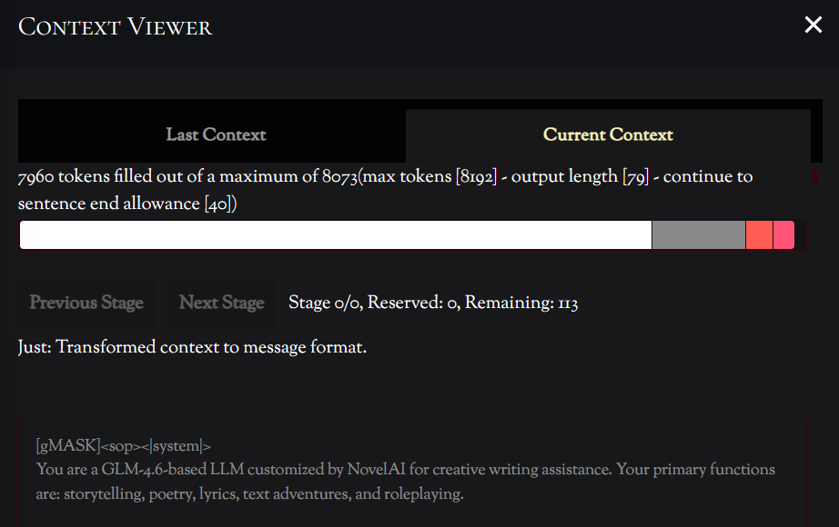

# Notes on *Neural Networks and Cognitive Science* (Simbrain textbook)

This is a collection of thought experiments and possible research questions related to AI alignment and safety, keyed to the [Simbrain textbook](https://github.com/simbrain/NeuralNetworksCogSciBook). Many of these are drawn from direct experience evaluating frontier models (with notes on how they might connect to cognitive science). The notes are constantly being updated.

| Notes | Book file |
|---|---|
| [LLM Chapter](notes/01-llm-chapter.md) | `Transformers.tex` |
| [AI Alignment Chapter](notes/02-ai-alignment-chapter.md) | `AI_Alignment.tex` |
| [Future Chapter: Research Notes](notes/03-future-chapter.md) | `Transformers.tex` §1.7 and parts of `AI_Alignment.tex` |
| [STATUS.md](STATUS.md) | Where every reference points right now, and which ones need a look |

## Line numbers that follow the book

The book's `.tex` files change constantly, so a plain "Line 183" goes stale as soon as someone edits a paragraph above it. In these notes, every line reference is a tracked link. A GitHub Action checks the book every 15 minutes and updates the links. Each link goes to the exact lines in the current version of the book on GitHub.

### How a reference is tracked

When you add a reference, the script saves a short fingerprint: the referenced line plus one line above and below it. On each run it does the following:

1. **Follows the diff.** It compares the book file at the last confirmed version with the newest version. If the referenced line itself is untouched, its new number comes straight out of the diff, however many lines were added or removed above it.
2. **Matches by text.** If the line was edited, it searches the file for the closest match to the fingerprint, preferring matches near where the line should be.
3. **Checks other files.** If the passage has left the file (for example, when §1.7 moves into its own chapter), it searches every other `.tex` file in the book.
4. **Reports the result.** Uncertain or missing matches are flagged in the note and listed in [STATUS.md](STATUS.md).

The `§` section labels are regenerated from the `\section` and `\subsection` headings each time, so section numbers stay correct too.

## Writing a reference

Type a short tag in any file under `notes/`:

| You type | It becomes |
|---|---|
| `[[L:Transformers.tex:183]]` | [Line 183](#) (capital L, for the start of a note) |
| `[[l:AI_Alignment.tex:344-422]]` | [lines 344-422](#) (lower-case l, for mid-sentence) |
| `[[§:Transformers.tex:183]]` | [§1.1 In-Context Processing](#) (the section that contains that line) |
| `[[L:Transformers.tex:183@1371c5d]]` | Same, but "line 183 as it was in commit `1371c5d`" |

Use the `@commit` form when the line number came from an older copy of the book (for example, an old PDF or a local checkout you haven't updated). Otherwise the tag is read against the newest version of the book.

A typical note looks like this:

```markdown
**[[L:Transformers.tex:183]] (lorebooks/anterograde amnesia)** [[§:Transformers.tex:183]]: Your note here...
```

After the next sync (which starts automatically when you push), the tag is rewritten into a tracked link like this:

```markdown
<!--ref:r001-->[Line 183](https://github.com/simbrain/NeuralNetworksCogSciBook/blob/<commit>/Transformers.tex#L183)<!--/ref-->
```

The `<!--ref:…-->` comments are invisible on GitHub, and they are how the script finds the link again. Leave them in place and edit the text around them freely. If you edit notes on your own computer, run `git pull` after pushing so you get the rewritten tags back.

### What the markers mean

| Shown after a link | Meaning | What to do |
|---|---|---|
| *(nothing)* | Located confidently | Nothing |
| ⚠️ | The passage was rewritten in place, or only a weak match was found | Open the link and check it. |
| ↪️ | Found in a different `.tex` file | Usually right (for example, a section that moved to a new chapter). Check it once. |
| ❌ | Could not be found | The text was probably deleted. That often means your suggestion was taken up, so it is worth a look. |

Flags stay until you clear them, even if later book edits make the match certain again, so nothing is dropped before you have looked at it. [STATUS.md](STATUS.md) lists every flagged reference with its id (such as `r017`). After checking:

- **The link is right** (or, for ❌, the passage really is gone): add the id to [`accept.txt`](accept.txt). This works from the GitHub web editor too. On the next sync, the flag is cleared and a ❌ reference is retired. A retired reference then reads "Line 501 (since removed from the book)" and is no longer searched for.
- **The link is wrong:** in the note, replace the whole `<!--ref:r017-->…<!--/ref-->` with a fresh tag such as `[[L:FromModelToMind.tex:64]]`.

## Images

Images live in [`images/`](images/) with descriptive names, and the notes reference them with relative paths:

```markdown

```

To set the width (useful for tall images), use an HTML tag instead:

```html

```

To add a new image, open the `images` folder on GitHub, choose **Add file → Upload files**, give the file a descriptive name, and reference it as above. Avoid pasting images straight into the GitHub editor: those uploads are stored outside the repository on GitHub's attachment server and are not part of the repo history.

Credits: the pig pose reference is a photo by [Clint Patterson on Unsplash](https://unsplash.com/photos/L7SPNy1el4M). The pigeon tarot card is my own artwork.

## Running the sync yourself

You only need git and Python 3 (standard library only):

```bash
git clone https://github.com/simbrain/NeuralNetworksCogSciBook.git ../book
python3 scripts/sync_refs.py --upstream ../book
```

## Layout

```
notes/                      the notes, one file per chapter
images/                     pictures used in the notes
STATUS.md                   generated: where every reference points now
.refs/refs.json             generated: fingerprints and positions of every reference
scripts/sync_refs.py        the tracker
.github/workflows/          runs the tracker every 15 minutes and on every push
docs/instant-sync.md        optional: let the book repo trigger a sync instantly
config.json                 upstream repo, branch, and chapter numbering
```

`config.json` → `chapter_numbers` sets the chapter number used in § labels for each file (it defaults to `1`, matching the numbering in a single-chapter build). For example, set `{"Transformers.tex": "18"}` to use the master book's chapter number instead.
